# Cuota

<p align="center">
  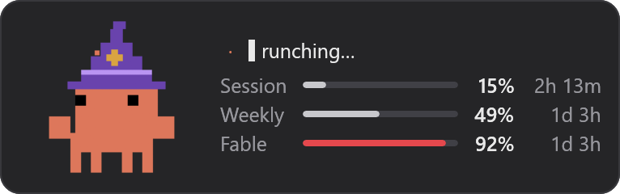
</p>

<p align="center">
  <a href="https://github.com/arshit09/Cuota/releases/latest"></a>
</p>

A tiny Windows widget that shows your Claude plan usage: session (5hr), weekly, and per-model limits. Same numbers as Claude Code's **Account & Usage** panel.

Clawd, the Claude Code mascot, acts out a random activity while Claude works: a new one whenever a session starts working, and another every so often. He greets you as work starts and celebrates when it's done, waits around for a minute after, then falls asleep until there's work again. Above the meters, a line says what he's up to, like Claude Code's spinner: a turning star, then *Percolating…*, *Spelunking…*, *Flibbertigibbeting…*, each new word typing itself over the last. The 62 animations come from [Mascot Studio](https://github.com/Harriszed/mascot-studio).

## Screenshots

**Clawd's moods**: working, waiting for a minute after a session goes idle, asleep once nothing is happening, and celebrating when work is done.

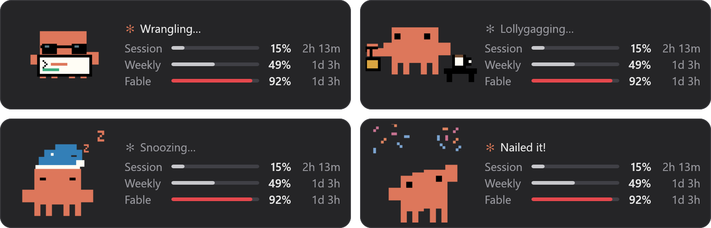

**Make it yours**: rings instead of bars, Clawd without his status line, or just the meters.

<p>
  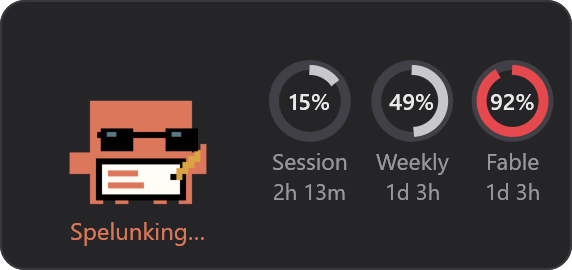
  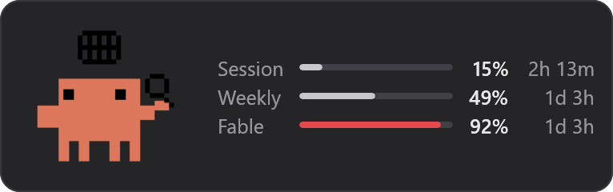
  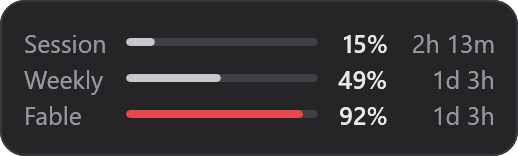
</p>

**Any size**: ten steps from 70% to 160%. Pick one in settings, or turn the mouse wheel over the panel.

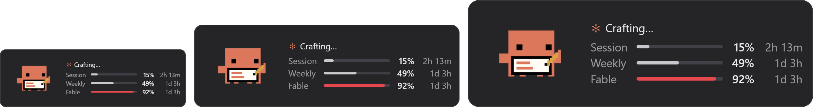

**Usage details**: double-click the panel to expand it with each limit's reset time and pace, and what your week went to.

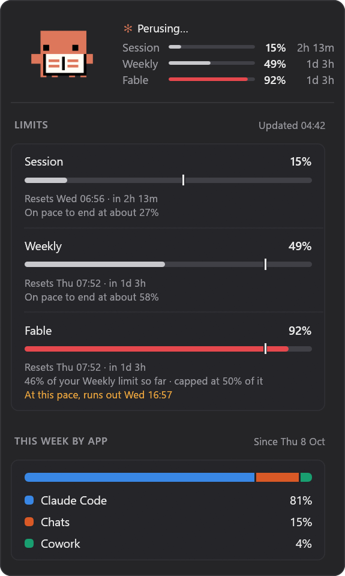

**Desktop pet**: just Clawd, out on your screen with nothing around him, walking about and doing what Claude's doing, with what he's up to under him. Rest the pointer on him for a card of your usage.

<p>
  
  &nbsp;&nbsp;
  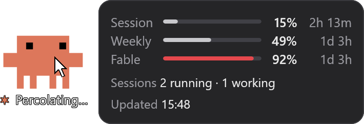
</p>

**Settings**: right-click the panel, or Clawd. Like Windows 11's Settings, it has a page for each part.

<table>
  <tr>
    <td>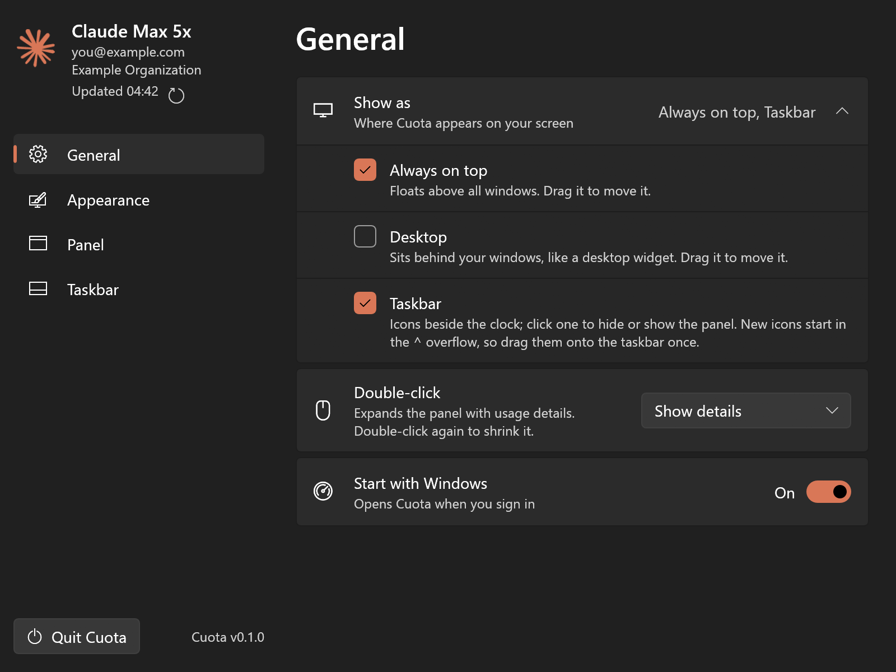</td>
    <td>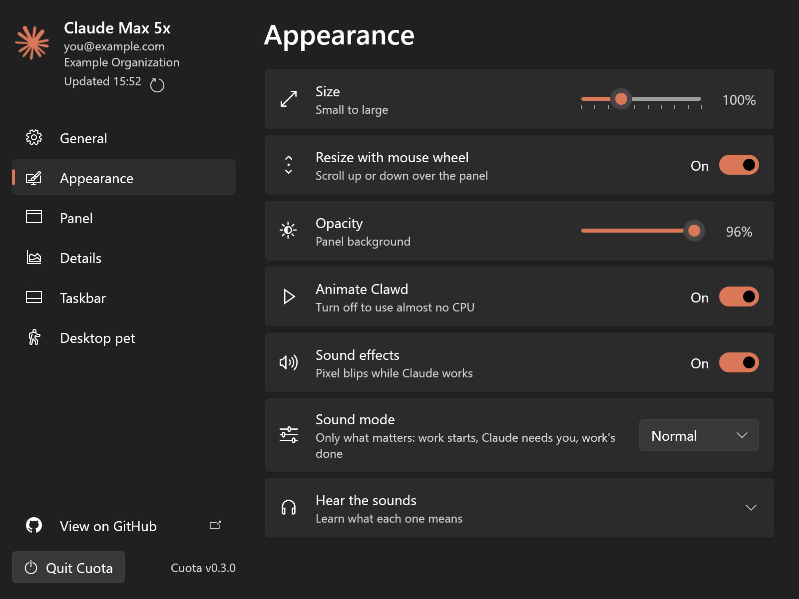</td>
  </tr>
  <tr>
    <td>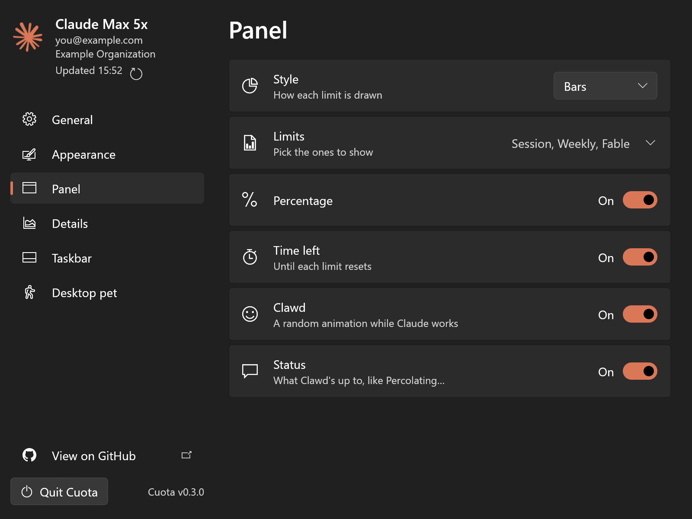</td>
    <td>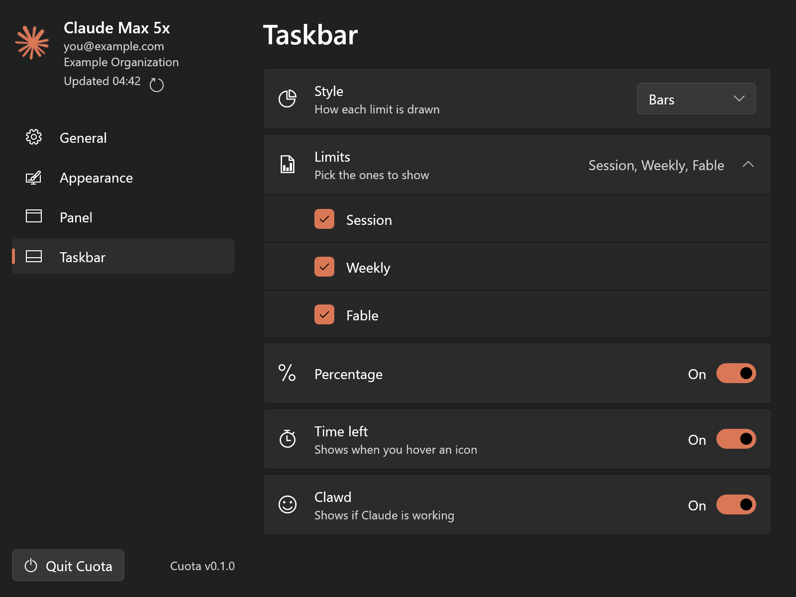</td>
  </tr>
  <tr>
    <td>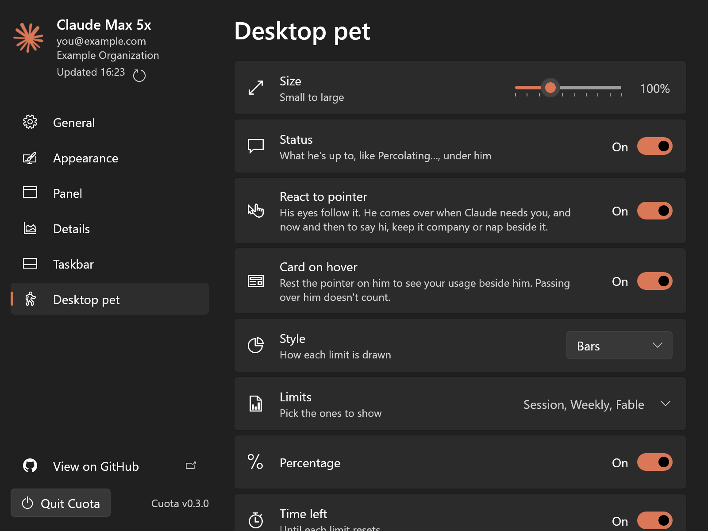</td>
    <td></td>
  </tr>
</table>

**Taskbar and tray menu**: with Show as set to Taskbar, Clawd dances by the clock while Claude works, and each limit gets an icon, as Bars or Pie (enlarged here). Right-click any of Cuota's icons for its menu.

<p>
  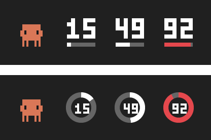
  &nbsp;&nbsp;
  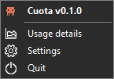
</p>

The screenshots use `--demo`'s made-up account and usage.

## Requirements

- Windows 10/11
- [Claude Code](https://claude.com/claude-code), logged in with Pro or Max (Cuota reuses that login)
- Rust, only to build it yourself

## Download, or build & run

Download **CuotaSetup.exe** from the [latest release](https://github.com/arshit09/Cuota/releases/latest), run it and click **Install**. It's unsigned, so if Windows says it protected your PC, click **More info**, then **Run anyway**. Setup puts Cuota in `%LOCALAPPDATA%\Programs\Cuota` (no admin rights needed; it asks only if that folder won't let it write), adds it to the Start menu and starts it. Uninstall it from **Settings › Apps**. Your settings are kept.

Prefer no installer? The release also has the portable **Cuota.exe**: it's self-contained, so copy it anywhere and run it.

Cuota checks for new releases once a day; when one is out, **Settings › Updates › Update now** downloads it, swaps it in for the old file and restarts. Your settings are kept.

Or build it yourself:

```powershell
cargo build --release
.\target\release\cuota.exe
```

`build-setup.bat` builds the setup too, into `target\dist\release\cuota-setup.exe`. To start Cuota when you sign in, turn on **Start with Windows** in its settings. Only one Cuota runs at a time: launching it again opens the running one's settings.

| Flag | Does |
|---|---|
| `--interval 120` | Refresh every 120 s while Claude is in use (default 60, min 30) |
| `--demo` | Show fake data |
| `--once` | Print usage to the terminal and exit |
| `--uninstall` | Remove the copy setup installed (Settings › Apps runs this) |

## Using it

**Right-click** Cuota for settings. It always has an icon in the tray by the clock, whose right-click menu has **Usage details**, **Settings** and **Quit**.

**Double-click** the panel to expand it with usage details, and again to shrink it. In settings, **Double-click** can instead open your usage page on claude.ai, the Claude app, or any file, program or script you pick. The details show:

- each limit's reset time and where it's headed at your current pace
- what your week went to: Claude Code, chats, Cowork
- your subscription and extra usage
- the Claude Code sessions running now
- Claude Code's replies, tool calls and tokens this week, by day, model and project, on this PC

To keep some of them in view, pick them on the **Details** page of settings: they show under the meters all the time, in the order you drag them into.

**Show as** (pick one or more):

- **Always on top**: floats above all windows
- **Desktop**: sits behind windows, like a desktop widget
- **Taskbar**: Clawd and each limit as tray icons. Click one for the panel.
- **Desktop pet**: just Clawd, out on your screen with no panel around him. Pick it alone to have only him.

Drag the panel to move it. Always on top and Desktop are the same panel, so only one can be on.

**Monitors** (in General): pick two or more monitors to put a copy of the panel on each. Each copy stays on its own monitor wherever you drag it there, and comes back to that spot next time. With one picked, there's just the panel, on that monitor, and you can drag it anywhere. **Identify**, at the foot of the list, shows each monitor's number on it for a moment, as Windows' display settings do, so you know which is which.

**Desktop pet**: Clawd walks about the screen on his own, legs going, and does what Claude's doing. At work he acts out a task and now and then scuttles somewhere new; with nothing going on he falls asleep, and every few minutes wakes up, ambles off and sleeps somewhere else. When Claude stops to ask you something, he tells you it's your turn until you answer. There's nothing around him: clicks anywhere but on Clawd himself reach whatever is behind him. His status line, like *Percolating…*, sits under him. Drag him anywhere, click him and he says hi, and right-click him for settings. He steps behind a full-screen game, video or presentation until it's done. On the **Desktop pet** page of settings:

- **Size**: ten steps, like the panel's.
- **Status**: the line under him, on or off.
- **React to pointer**: his eyes follow the pointer, and he walks over to it when Claude needs you. Now and then he comes to say hi, keeps it company (following when it moves off), or naps beside it.
- **Travel across monitors**: off at first, he keeps to the monitor he's on. Turn it on and pick monitors under **Monitors** (with **Identify**, as for the panel), and he walks over to them too, crossing where they meet: now and then he goes off to sleep on another one, and he comes to the pointer on any of them.
- **Card on hover**: rest the pointer on him to see a card of usage beside him. A pointer just passing over him, or him walking under a still one, doesn't count. Pick the card's style, limits and details on the same page, and drag the details into order. Double-click him to show it straight away.

**Move aside for the pointer** (in General, off at first): to click something behind the panel, just head for it. When the pointer slows down coming toward the panel, as it does before a click, the panel slides out of the way, and it slides back once the pointer has left its spot. Passing quickly over it, or idling beside it, leaves it where it is. To use the panel itself, hold **Ctrl** as you point at it; it then stays put until the pointer leaves it.

Settings has a page for each part, picked in its sidebar: **General** (Show as, Monitors, Double-click, Move aside for the pointer, Start with Windows), **Appearance** (the panel's size and opacity, and Clawd's animation), **Sounds** (8-bit sound effects: Normal plays only what matters, like work starting, Claude asking you something and work finishing, while Lively adds a sound for each kind of step; a list plays each one so you can learn them), **Panel** and **Taskbar**, which each set what that one shows: Bars or Pie, which limits, percentage, time left, and Clawd, with or without his status line above the meters in the panel, **Desktop pet** (above), **Usage**, and **Updates** (check now, update to a new release, or turn off the daily check). **View on GitHub**, at the foot of the sidebar, opens this repository.

Tips:

- Hover a meter for its exact reset time.
- Meters turn amber at 75% and red at 90%.
- Turn off *Animate Clawd* to use almost no CPU.

## How it works

- Reads Claude Code's login token from `%USERPROFILE%\.claude\.credentials.json` (or `CLAUDE_CONFIG_DIR`, or `CLAUDE_CODE_OAUTH_TOKEN`).
- Calls `api.anthropic.com/api/oauth/usage`, the same endpoint Claude Code uses. The token goes only to Anthropic.
- For usage details, reads Claude Code's session transcripts in `%USERPROFILE%\.claude\projects`, only while the panel is expanded or shows a detail from them. They stay on your PC.
- Never writes to Claude's files. Its own settings live in `%APPDATA%\Cuota\settings.json`.
- Once a day (unless turned off in **Updates**), asks `api.github.com` for this repository's latest release. It sends nothing about you. Updating downloads that release's `Cuota.exe` beside the running one, renames the running one to `Cuota.exe.old`, starts the new one and quits; the new one deletes the old file.
- Logs rate limits, failed requests, crashes and other problems to `%LOCALAPPDATA%\Cuota\Logs\cuota.log`. Past 1 MB it moves to `cuota.old.log`, so the log stays small. The log leaves out your email and what your sessions are about.

API calls stay rare: about once a minute while Claude is working, once more when it stops, and none while it's idle (the Refresh button still asks). It also reuses usage Claude Code already fetched.

The endpoint is undocumented, so a Claude update could break it.

## Troubleshooting

| Problem | Fix |
|---|---|
| *Login token expired* | Send a message in Claude Code. Cuota picks up the new token within 15 s. |
| *No Claude login found* / *Login rejected* | Run `claude`, then `/login`. |
| *Rate limited* | Cuota backs off on its own. Try a longer `--interval`. |
| Taskbar icons missing | Click **^** by the clock and drag the Cuota icons onto the taskbar. |
| Anything else | Open **Settings › General › Log file** to see what Cuota ran into, and attach `cuota.log` to an issue. |

## License

Cuota's code is free software, licensed under the [GNU General Public License v3.0](LICENSE) or any later version. You can use it, change it, share it and even sell it. If you share Cuota or anything built from its code, changed or not, you have to share the source code too, under the same license.

The license covers Cuota's own code only. It doesn't cover Clawd's animations in `assets/mascot`, Anthropic's names, logo or mascot, GitHub's logo, or the screenshots in `docs/screenshots`, which show them. See [Credits and legal notice](#credits-and-legal-notice).

## Credits and legal notice

Cuota is an unofficial project. It isn't made, endorsed or supported by Anthropic, and has no affiliation with Anthropic.

**Anthropic's names, logo and mascot.** Claude, Claude Code and Anthropic are trademarks of Anthropic PBC. The Claude logo and Clawd, the Claude Code mascot, are Anthropic's too. Cuota and its author don't own any of them. Cuota uses the names only to say which product it works with, and Anthropic hasn't reviewed or approved Cuota or how it uses any of them.

- The Claude spark (Cuota's window icon and the logo in the panel) and the tray's pixel-art Clawd are drawn from `claude-logo.svg` and `clawd.svg`, which ship with Anthropic's Claude Code extension for VS Code. Claude Code is © Anthropic PBC, all rights reserved, and its use is subject to [Anthropic's Commercial Terms of Service](https://www.anthropic.com/legal/commercial-terms).
- See Anthropic's [trademark guidelines](https://www.anthropic.com/legal/trademark-guidelines) before you use any of these in your own work.

**Clawd's animations.** The 62 GIFs in [assets/mascot](assets/mascot) come from [Mascot Studio](https://github.com/Harriszed/mascot-studio), an unofficial community project by Harriszed, built on [Ayotomiwa Wale-Durojaye's reference animation](https://ayotomcs.me/claude-mascot). Neither grants a license to the artwork. As of 2026-10-14:

- Mascot Studio has no license. Its notice, copied unchanged in [assets/mascot/NOTICE.md](assets/mascot/NOTICE.md), says it grants no open-source or commercial-use license and that permission to redistribute the artwork is unverified.
- The reference animation's page says "© Copyright 2025" and gives no permission to reuse it.
- The character they draw is Anthropic's.

The GIFs are here, with credit, for personal, non-commercial use. Being in this repo gives you no rights to them, and Cuota's license doesn't apply to them. They're built into the exe (about 3.5 MB of it), so the same goes for any `cuota.exe` you build. Get permission from their owners before you reuse them, share them, or share a build that includes them.

**GitHub's logo.** The GitHub mark on the settings' link to this repo is GitHub, Inc.'s. Its outline is `mark-github` from GitHub's [Primer Octicons](https://github.com/primer/octicons) (MIT License). See GitHub's [logo guidelines](https://github.com/logos) before you use it in your own work.

**Removal.** If you own any of this and want it taken down, [open an issue](https://github.com/arshit09/Cuota/issues) and it will be removed.

**No warranty.** Cuota is provided as is, without warranty of any kind. It uses your Claude Code login and an undocumented Anthropic endpoint, so use it at your own risk.
